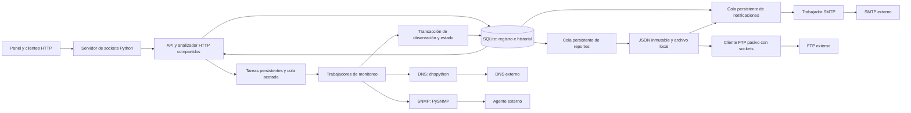
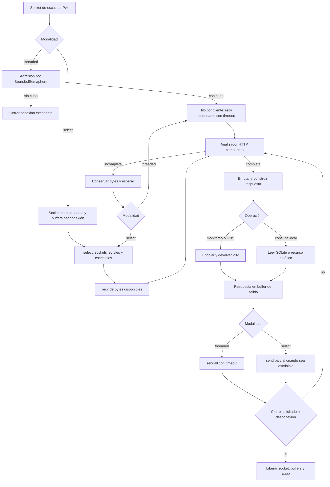

# Arquitectura, concurrencia y recuperación

[Inicio](../README.md) · [Implementación](implementation-guide.md) · [Protocolos](protocols.md)

La aplicación Python se ejecuta en el anfitrión; DNS, el agente SNMP, SMTP y FTP son
servicios externos. HTTP y FTP usan sockets directos. PySNMP, dnspython y smtplib
implementan los intercambios restantes sin sustituir la arquitectura concurrente.

## Componentes y flujo integrado

Registrar un dispositivo no ejecuta una consulta. Una petición de monitoreo obtiene 202
y una tarea consultable; el trabajador resuelve el nombre, consulta SNMP y registra la
observación. La transacción incluye disponibilidad, incidente si corresponde, notificación,
reporte y finalización de la tarea que posee el trabajador. Un incidente repetido sin
cambio de condición no produce copias ilimitadas de la misma transición.

SMTP y reportes tienen trabajadores separados. No se garantiza que el correo del incidente
termine antes que el reporte. La generación del documento encola su propio correo; la
subida FTP solo queda `uploaded` después de releer y verificar contenido. La consulta HTTP
de reportes usa SQLite, sin leer del FTP ni esperar operaciones de red externas.

Las consultas DNS solicitadas desde el panel tienen una cola independiente, acotada y
temporal. Sus resultados no son tareas persistentes de monitoreo.

## Atención de conexiones

En `threaded`, una conexión admitida ocupa un hilo HTTP y un cupo hasta su cierre. La
espera de un cliente no impide atender los demás. En `select`, un bucle mantiene entrada,
salida, actividad y cierre por socket; envía solamente los bytes que el sistema admite.
El modo no dedica un hilo HTTP a cada cliente, pero sí utiliza los trabajadores comunes
de monitoreo, DNS y entregas.

Ambos soportan conexiones persistentes, recepción fragmentada y solicitudes consecutivas;
limitan clientes, encabezados, cuerpos y salida encolada. Cierran conexiones inactivas.
Un fallo inesperado de un manejador se registra y responde 500 a ese cliente sin detener
el servicio. Una delimitación inválida responde 400 y cierra para evitar reinterpretar bytes.

Las operaciones de DNS/SNMP/SMTP/FTP se ejecutan fuera del bucle HTTP. Las consultas y
transacciones breves de SQLite siguen siendo síncronas: una espera de disco o un bloqueo
de base puede retrasar `select`. No se afirma que todo el almacenamiento sea no bloqueante.

## Sincronización y secciones críticas

| Mecanismo | Uso concreto | Qué podría ocurrir sin él |
| --- | --- | --- |
| `threading.Lock` | Conexión SQLite compartida; admisión/caché del coordinador; conjunto de clientes HTTP y mapa de consultas DNS | Transacciones o modificaciones de colecciones entrelazadas, doble admisión o limpieza sobre datos cambiantes |
| `threading.BoundedSemaphore` | Cupos HTTP con hilos y capacidad total del coordinador antes de admitir tareas | Hilos/tareas sin límite; consumo creciente de memoria y sockets. Su límite también detecta liberaciones de más |
| `threading.Event` | Señales de cierre, parada de trabajadores y pérdida/restablecimiento de paquetes en el relay de demo | Hilos que no observan el cierre o coordinación mediante esperas activas y banderas dispersas |
| `queue.Queue` acotada | Entrega segura de tareas a trabajadores, espera con timeout y seguimiento `task_done` | Competencia por una lista compartida, pérdida/doble extracción de tareas o memoria sin límite |
| Transacciones y restricciones SQLite | `BEGIN IMMEDIATE`, nombre único, un trabajo activo por dispositivo, evento de notificación único y reporte único por incidente | Dos procesos podrían leer el mismo estado previo, duplicar trabajo/eventos o guardar solo parte del incidente |

Un `Lock` solo coordina hilos de una instancia. Los procesos que comparten el archivo
se coordinan mediante transacciones, restricciones y reservas temporales en SQLite.
Las operaciones de red se ejecutan **fuera de los bloqueos de almacenamiento**.

El número de trabajadores limita las consultas activas; la admisión total es
`workers + queue_capacity`. Los trabajadores de SMTP y reportes procesan sus propias
colas persistentes sin crear un hilo por entrega. El mapa de sockets de `select` tiene
un único responsable y limita clientes sin usar un semáforo por conexión.

## Persistencia y estados

SQLite usa esquema versión 4 y migraciones aditivas transaccionales. Una base con versión
posterior se rechaza; no se reinicializa para ocultar el problema.

| Tabla | Datos y garantías |
| --- | --- |
| `devices` | UUID, nombre único, host original, puerto y disponibilidad almacenada |
| `monitoring_jobs` | Instantánea del dispositivo, estados, propietario, reserva, resultado y error; una tarea activa por dispositivo |
| `monitoring_results` | Observación identificada, UTC, valores/errores, `applied` y disponibilidad resultante |
| `incidents` | Transición y descripción, identidad del dispositivo y relación con resultado |
| `notifications` | Evento único, mensaje, intentos, próxima fecha, reserva y estado SMTP |
| `reports` | Un documento por incidente, JSON, hash, estados, intentos y recibo FTP |

Una observación atrasada se conserva con `applied=false` y no revierte el estado vigente.
Repetir el mismo ID y contenido devuelve un recibo de duplicado; reutilizarlo con datos
diferentes se rechaza. Si el trabajador perdió la propiedad de una tarea, registrar la
observación revierte la transacción completa. Los errores DNS/protocolo no reemplazan la
disponibilidad previa por una caída física inventada.

La fuente del reporte es su JSON persistido. La escritura local usa archivo temporal y
reemplazo atómico. Una consulta HTTP de descarga devuelve esos bytes y comprueba su hash,
conservando números originales. Los objetos de la API convierten enteros que exceden la
precisión de JavaScript a texto.

## Reservas, reintentos y cierre

Cada tarea/entrega se reclama con propietario o token y fecha de vencimiento. Al cerrar
normalmente, se terminan operaciones activas y se liberan tareas de monitoreo en espera
para recuperación. Un reinicio tras caída abrupta reclama trabajo cuyo propietario quedó
sin reserva vigente; no roba trabajo activo de otra instancia. Los fallos de entrega
transitorios usan espera exponencial y máximo de intentos; los definitivos requieren
corregir la causa y reactivar la entrega explícitamente.

SIGINT/SIGTERM solicitan parada. `Lifecycle` avisa a los componentes antes de esperarlos,
termina atención HTTP, une trabajadores y cierra almacenamiento al final. Las devoluciones
de llamada de limpieza se protegen individualmente: un fallo no impide intentar las demás.
También se limpian recursos adquiridos antes de una falla durante el arranque. Los
manejadores de señales se restauran después de liberar los recursos.

La duración del cierre depende de las operaciones activas y sus plazos; no se vacían
indefinidamente todas las colas antes de salir. Las consultas DNS web pendientes se
cancelan. Las tareas persistentes de monitoreo y las entregas quedan recuperables.

SMTP puede aceptar un mensaje y perderse su confirmación antes de que la aplicación lo
registre. El ID de mensaje estable y las reservas reducen duplicados, pero no equivalen
a entrega exactamente una vez de extremo a extremo. Un fallo de QUIT tras DATA aceptado
no se convierte en reintento. FTP puede dejar contenido parcial si falla una carga;
el cliente lo informa y no marca verificación exitosa.

## Alcance

El sistema ejecuta sondeos a petición, sin programador periódico. No incluye autenticación
HTTP, TLS, retención automática ni despliegue productivo. La comparación de modalidades
se encuentra en [requisitos y evidencias](requirements.md): usa el mismo trabajo y
registra tiempos/hilos, sin extrapolar una prueba local a capacidad de producción.
