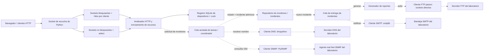
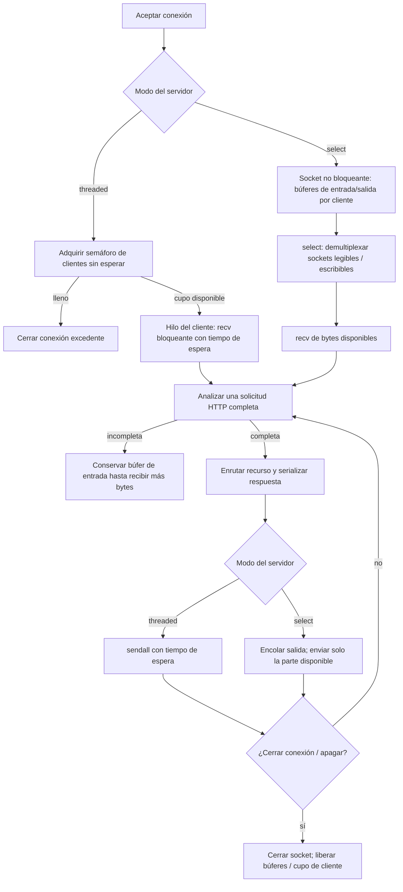

# Arquitectura y plan de implementación

Este diseño sigue las secciones 3–9 de `PROYECTO FINAL.pdf`. Las conexiones
continuas muestran la base funcional; las punteadas, la integración prevista.
Los dos modos del servidor comparten delimitación de mensajes, enrutamiento y
almacenamiento para comparar su comportamiento de forma justa.

## Gestión de conexiones

El servidor con hilos acepta conexiones bloqueantes y mantiene un hilo por
cliente admitido. El servidor select llama directamente a `select.select()`,
mantiene búferes por cliente y gestiona lecturas/escrituras parciales sin un hilo
dedicado por cliente. Ambos admiten conexiones HTTP/1.1 persistentes, limitan el
tamaño de las solicitudes y cierran conexiones inactivas o interrumpidas. Select
es útil para muchos clientes mayormente inactivos; los hilos simplifican las
operaciones bloqueantes. Mide ambos en lugar de suponer cuál será mejor.

Los manejadores actuales de select ejecutan operaciones breves de SQLite de forma
síncrona. El acceso a disco puede retrasar brevemente el bucle. Antes de agregar
monitoreo, FTP, generación de reportes u otros manejadores lentos, mueve esas
operaciones a tareas de trabajadores con límites y devuelve 202 con un recurso
de tarea. Los trabajadores deben devolver los resultados mediante una cola; no
deben escribir en los sockets de los clientes. Ninguna operación de red de los
protocolos debe ejecutarse dentro del bucle select.

## Datos compartidos y sincronización

| Primitiva | Uso actual y sección crítica | Consecuencia de eliminarla |
| --- | --- | --- |
| `threading.Lock` | Serializa el acceso a la conexión SQLite compartida, incluidas inserciones y transacciones; protege por separado el conjunto de clientes activos durante el cierre | Podrían solaparse transacciones o producirse condiciones de carrera al obtener instantáneas o limpiar conexiones |
| `threading.BoundedSemaphore` | Limita los clientes con hilos admitidos antes de crear cada hilo; se libera en `finally` | Los clientes inactivos podrían agotar los hilos y recursos de sockets |
| `threading.Event` | Comunica SIGINT/SIGTERM o el cierre solicitado por las pruebas al bucle de aceptación y a los trabajadores | La coordinación del cierre dependería de indicadores sin sincronización o dejaría bucles en ejecución |

El modo select limita los clientes mediante su mapa de conexiones gestionado por
un único responsable. El registro almacena UUID, nombre único, nombre DNS/IP,
puerto SNMP y estado. El estado `unknown` significa que no se ha registrado ningún
resultado real de monitoreo. Las transacciones SQLite conservan los dispositivos
entre reinicios; las restricciones de unicidad rechazan nombres duplicados.

Siguiente paso: agregar una `queue.Queue` acotada para tareas de monitoreo y entrega
de incidentes, y un semáforo para limitar consultas/transferencias salientes.
Actualizar el estado del dispositivo, el resultado de monitoreo y el incidente en
**una sola transacción**. Ejecutar DNS/SNMP/SMTP/FTP fuera de los bloqueos de
almacenamiento. No mantener bloqueado el registro mientras se espera una respuesta
de red. Persistir el estado de entrega para que reintentar SMTP/FTP no borre incidentes.

## Etapas de los adaptadores de protocolos

Los contratos están en `src/network_monitor/protocols/__init__.py`. Los adaptadores
concretos deben ubicarse en `ftp.py`, `snmp.py`, `smtp.py` y `dns.py` de ese paquete.

1. DNS: consultar A, AAAA y MX con dnspython contra un servidor/puerto configurable;
   distinguir NXDOMAIN, ausencia de respuesta y tiempo de espera agotado. Conservar
   los nombres de host en el registro y guardar las direcciones IPv4 resueltas en
   los resultados de monitoreo.
2. SNMP: usar PySNMP para consultar información del sistema, tabla de interfaces y
   contadores de tráfico de un agente real. Comenzar con OID numéricos como sysDescr.0
   (`1.3.6.1.2.1.1.1.0`), sysUpTime.0 (`1.3.6.1.2.1.1.3.0`), ifNumber.0
   (`1.3.6.1.2.1.2.1.0`) e ifTable (`1.3.6.1.2.1.2.2`). Registrar marcas de tiempo,
   OID, valores tipados, tiempos de espera agotados y errores de protocolo.
3. FTP: implementar el análisis de respuestas de control (incluidas respuestas de
   varias líneas), USER/PASS, TYPE I, PASV, LIST, RETR, STOR y QUIT directamente
   con `socket`. Abrir una conexión TCP de datos por transferencia y consumir su
   respuesta final de control. Validar la finalización y comparar hashes de
   archivos. No usar `ftplib`.
4. SMTP: usar `smtplib` y `email.message` para enviar nombre/IP del dispositivo,
   marca de tiempo del evento, tipo de incidente y descripción. Capturar el
   intercambio EHLO, MAIL FROM, RCPT TO, DATA y QUIT para el informe técnico.
   Reintentar los errores transitorios con límites.
5. Coordinador: resolver → consultar → actualizar resultado/estado/incidente en una
   transacción → notificar caídas/recuperaciones/eventos anómalos → crear reporte
   del incidente → subir por FTP. Generar un reporte de incidente también activa
   la notificación requerida.
6. HTTP/interfaz: agregar recursos de tareas de monitoreo, estado actual, historial
   de incidentes, estadísticas y reportes; mostrarlos en una interfaz del navegador
   conservando el manejo de solicitudes con sockets directos. Definir métodos y
   validaciones por ruta a medida que se agreguen rutas.

## Errores y limitaciones

La base inicial devuelve errores JSON para solicitudes malformadas, campos de
dispositivos inválidos, duplicados, métodos no admitidos y recursos inexistentes.
Una delimitación inválida cierra la conexión para evitar interpretar bytes
sobrantes como otra solicitud. Los tiempos de espera agotados y reinicios de
conexión liberan los recursos del cliente afectado. Las conexiones que superan el
límite configurado se cierran al admitirlas. SIGINT/SIGTERM detiene la aceptación,
desbloquea los clientes con hilos, espera a los trabajadores y finalmente cierra
el almacenamiento.

Después deben agregarse respuestas ante fallas de aplicación/almacenamiento y
registros estructurados, tiempos de espera/reintentos salientes acotados, pruebas
de recuperación, nombres seguros de reportes y vaciado ordenado de las tareas en
cola. Un tiempo de espera agotado no debe inventar un resultado SNMP; distingue un
destino inaccesible de una falla DNS o de autenticación/configuración. Una falla
SMTP o FTP debe conservar el incidente registrado y permitir reintentar su entrega.

Esta es una base para laboratorio local: autenticación, TLS, una implementación
HTTP completa y despliegue en producción quedan fuera del alcance actual. El
laboratorio proporciona servicios reales; eso no demuestra que los adaptadores
de la plataforma estén implementados.
