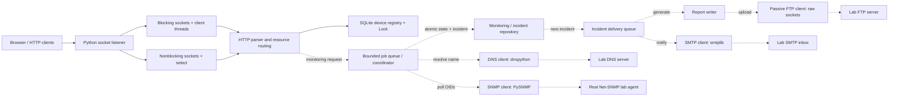
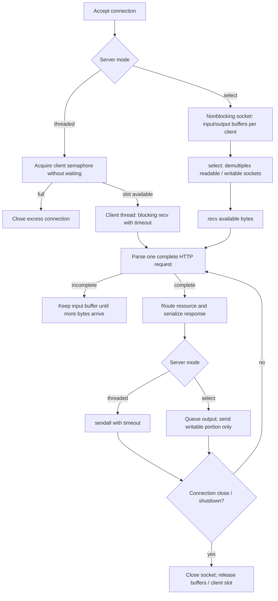

# Architecture and implementation plan

This design follows sections 3–9 of `PROYECTO FINAL.pdf`. Solid links below show
the working starter; dotted links show planned integration. The two server modes
share framing, routing and storage so their behavior can be compared fairly.

## Connection handling

The threaded server accepts blocking connections and owns one thread per admitted
client. The select server calls `select.select()` directly, owns per-client
buffers, and handles partial reads/writes without a dedicated client thread.
Both support persistent HTTP/1.1 connections, enforce request size limits, and
close idle or broken connections. Select is useful for many mostly idle clients;
threads simplify blocking operations. Measure both instead of assuming a winner.

Current select request handlers perform short SQLite operations synchronously.
Disk access can briefly delay the loop. Before adding monitoring, FTP, report
generation or other slow handlers, move those operations to bounded worker jobs
and return 202 with a job resource. Workers must pass completions back through a
queue; they must not write to client sockets. No protocol network operation may
run inside the select loop.

## Shared data and synchronization

| Primitive | Current use and critical section | Consequence of removing it |
| --- | --- | --- |
| `threading.Lock` | Serialize shared SQLite connection access, including each insertion and transaction; separately guard active client membership during shutdown | Transactions could overlap or snapshots/connection cleanup could race |
| `threading.BoundedSemaphore` | Bound admitted threaded clients before creating a thread; release in `finally` | Idle clients could exhaust threads and socket resources |
| `threading.Event` | Communicate SIGINT/SIGTERM or test shutdown to the accept loop and workers | Shutdown coordination would rely on unsynchronized flags or leave loops running |

The select mode bounds clients by its single-owner connection map. The registry
stores UUID, unique name, DNS name/IP, SNMP port and status. Its `unknown` status
means no real monitoring result has been recorded. SQLite transactions preserve
registered devices across restarts; uniqueness constraints reject duplicate names.

Next: add a bounded `queue.Queue` for monitoring jobs and incident delivery, and a
semaphore for outbound polling/transfer limits. Update device status, monitoring
result and incident in **one transaction**. Perform DNS/SNMP/SMTP/FTP operations
outside storage locks. Do not hold a registry lock while waiting for a network
response. Persist delivery status so retrying SMTP/FTP does not erase incidents.

## Protocol adapter milestones

Contracts live in `src/network_monitor/protocols/__init__.py`. Concrete adapters
should live in `ftp.py`, `snmp.py`, `smtp.py`, and `dns.py` in that package.

1. DNS: query A, AAAA, MX with dnspython against a configurable server/port;
   distinguish NXDOMAIN, no answer and timeout. Preserve hostnames in the registry
   while recording resolved IPv4 addresses on monitoring results.
2. SNMP: use PySNMP to query a real agent's system information, interface table and
   traffic counters. Begin with numeric OIDs such as sysDescr.0
   (`1.3.6.1.2.1.1.1.0`), sysUpTime.0 (`1.3.6.1.2.1.1.3.0`), ifNumber.0
   (`1.3.6.1.2.1.2.1.0`) and ifTable (`1.3.6.1.2.1.2.2`). Record timestamps, OIDs,
   typed values, timeouts and protocol errors.
3. FTP: implement control reply parsing (including multiline replies), USER/PASS,
   TYPE I, PASV, LIST, RETR, STOR, QUIT directly with `socket`. Open a separate TCP
   data connection for each transfer and consume its final control reply. Validate
   transfer completion and compare file hashes. Do not use `ftplib`.
4. SMTP: use `smtplib` and `email.message` to send device name/IP, event timestamp,
   incident type and description. Capture the EHLO, MAIL FROM, RCPT TO, DATA and
   QUIT exchange for the technical report. Retry transient errors with bounds.
5. Coordinator: resolve → query → transactionally update result/status/incident →
   notify on down/recovered/abnormal events → write incident report → upload FTP.
   A generated incident report also triggers the required notification.
6. HTTP/UI: add monitoring jobs, current status, incident history, statistics and
   report resources; expose them in a browser interface while retaining raw socket
   request handling. Define route-specific methods and validation as routes grow.

## Errors and limitations

The starter returns JSON errors for malformed requests, invalid device fields,
duplicates, unsupported methods and missing resources. Invalid framing closes the
connection so leftover bytes cannot be treated as a new request. Timeouts and
connection resets clean up the affected client. Admission beyond the configured
client limit closes the excess connection. SIGINT/SIGTERM stops acceptance,
unblocks threaded clients, joins workers, and finally closes storage.

Next, add application/storage failure responses and structured logs, bounded
outbound timeouts/retries, recovery tests, safe report filenames, and graceful
draining of queued work. A timeout must not fabricate an SNMP result; distinguish
an unreachable target from a DNS or authentication/configuration failure. SMTP
or FTP failure must preserve the recorded incident and leave delivery retryable.

This is a local lab starter: authentication, TLS, a full HTTP implementation and
production deployment are outside its current scope. The laboratory supplies
real services; it is not evidence that the platform adapters are implemented.
